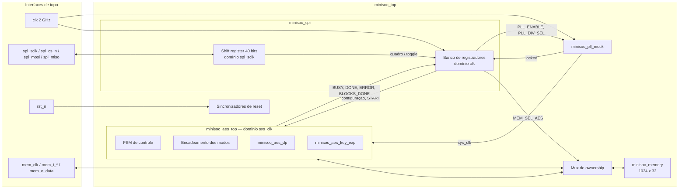
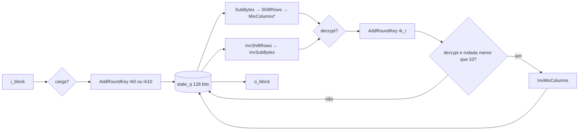
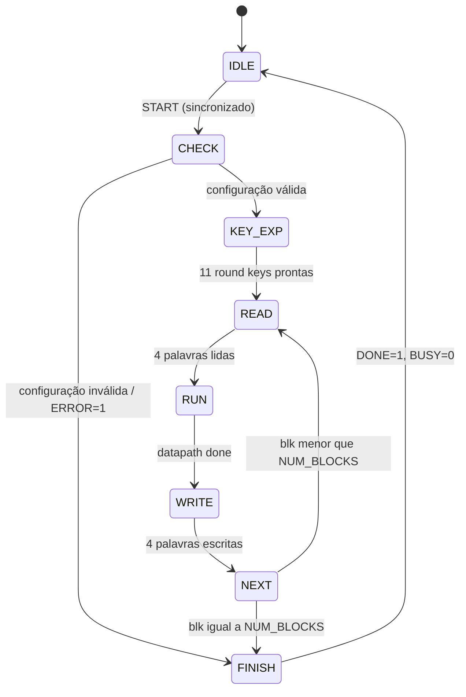
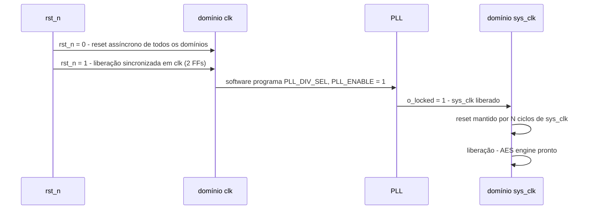

# Microarquitetura — MiniSoC AES (v1.0)

Documento de microarquitetura do MiniSoC AES. O Block Guide MiniSoC AES
v1.0.0 fixa as interfaces de topo, os módulos e arquivos, o mapa de
registradores e o protocolo SPI; este documento define **como** cada bloco é
implementado.

Referências às seções do Block Guide aparecem como **BG §n**. Pontos que
dependem de respostas às dúvidas registradas em `docs/reports/semana_02.md`
aparecem como **[Dúvida n]** e indicam a hipótese adotada.

## 1. Visão geral

| Bloco | Arquivo | Domínio de clock |
|-------|---------|------------------|
| Integração | `rtl/minisoc_top.sv` | — |
| SPI front-end e banco de registradores | `rtl/minisoc_spi/minisoc_spi.sv` | `spi_sclk` (recepção/transmissão) e `clk` (banco) |
| PLL mock | `rtl/minisoc_pll/minisoc_pll_mock.sv` | `clk` → gera `sys_clk` |
| AES engine | `rtl/minisoc_aes/minisoc_aes_top.sv` | `sys_clk` |
| Datapath AES-128 | `rtl/minisoc_aes/minisoc_aes_dp.sv` | `sys_clk` |
| Expansão de chave | `rtl/minisoc_aes/minisoc_aes_key_exp.sv` | `sys_clk` |
| Transformações de rodada | `rtl/minisoc_aes/minisoc_aes_{sbox,sub_bytes,shift_rows,mix_columns,add_round_key}.sv` e inversas | combinacionais |
| Memória compartilhada | `rtl/minisoc_mem/minisoc_memory.sv` | `mem_clk` ou `sys_clk`, conforme o dono |

## 2. Convenções

- **Estado AES:** byte *n* em `[127-8n -: 8]` (byte 0 em `[127:120]`), com
  *r* = *n* mod 4 e *c* = *n* div 4. A coluna *c* ocupa `[127-32c -: 32]`.
  É a mesma ordem de bytes do Block Guide: a Word 0 de um bloco é `[127:96]`
  (BG §7.1) e `KEY0 = cfg_key[127:96]` (BG §6).
- **Reset:** ativo em nível baixo, assíncrono na ativação e síncrono na
  liberação (em cada domínio).
- **Nomes:** entradas `i_*`, saídas `o_*`, registradores `*_q`, próximo
  estado `*_d`.

## 3. AES engine

### 3.1 Microarquitetura do datapath: iterativa, uma rodada por ciclo

O datapath (`minisoc_aes_dp`) tem **um registrador de estado de 128 bits** e
uma lógica de rodada combinacional reutilizada nas 10 rodadas.

`*` MixColumns é omitido na rodada 10. Na decriptação a ordem segue a cifra
inversa da FIPS-197 (§5.3): InvShiftRows → InvSubBytes → AddRoundKey →
InvMixColumns (omitido na última rodada).

**Latência:** 1 ciclo de carga (AddRoundKey inicial) + 10 rodadas =
**11 ciclos de `sys_clk` por bloco**.

**Interface:**

| Sinal | Dir. | Descrição |
|-------|------|-----------|
| `i_start` | I | inicia o processamento de `i_block` (pulso) |
| `i_decrypt` | I | 0 = cifra, 1 = cifra inversa |
| `i_block[127:0]` | I | bloco de entrada |
| `o_rk_idx[3:0]` | O | índice da round key pedida à expansão de chave |
| `i_rk[127:0]` | I | round key correspondente |
| `o_block[127:0]` | O | bloco de saída (válido com `o_done`) |
| `o_done` | O | pulso de um ciclo ao fim do bloco |

**Justificativa.**

| Alternativa | Área | Latência/bloco | Comentário |
|-------------|------|----------------|------------|
| **Iterativa, 1 rodada/ciclo (escolhida)** | 1 lógica de rodada + 128 FFs | 11 ciclos | equilíbrio entre área e desempenho |
| Desenrolada (10 rodadas em hardware) | ~10× a lógica de rodada | 1 ciclo ou pipeline | área incompatível com o propósito do projeto |
| Iterativa por coluna (32 bits) | ~¼ da lógica de rodada | ~44 ciclos | menor área, controle mais complexo |

A arquitetura iterativa é a forma usual em IPs AES compactos, tem controle
simples (contador de rodadas) e deixa a lógica ociosa fácil de identificar
para as técnicas de baixo consumo (clock gating do `sys_clk` do engine quando
ocioso, Semana 12).

**Risco de timing.** O caminho crítico é uma rodada completa (S-box → ShiftRows
→ MixColumns → XOR, mais o mux cifra/decifra). Com `sys_clk` de até 2 GHz
(PLL_DIV_SEL = /1), esse caminho dificilmente fecha numa única rodada por
ciclo. As frequências-alvo serão definidas pelo instrutor (Semana 8); se o
timing não fechar, as opções são: (a) operar com divisores maiores; (b) dividir
a rodada em dois ciclos (registrador após SubBytes/ShiftRows). A interface
start/done do datapath não muda em nenhum dos casos.

### 3.2 Expansão de chave: pré-computada, uma vez por operação

O `minisoc_aes_key_exp` calcula as **11 round keys** uma vez, logo após o
START, e as guarda em um banco de 11 × 128 bits. O datapath lê a round key
pelo índice (`o_rk_idx`).

- A chave não muda durante uma operação (é capturada no START, BG §8.3), então
  as round keys são reaproveitadas pelos até 256 blocos.
- A expansão é iterativa: uma round key por ciclo, **10 ciclos** por operação.
- Na decriptação, as chaves são simplesmente lidas em ordem inversa
  (rk10 → rk0), sem lógica adicional.

| Alternativa | Armazenamento | Custo por bloco | Decriptação |
|-------------|---------------|-----------------|-------------|
| **Pré-computada (escolhida)** | 1408 FFs (11 × 128) | nenhum | trivial (ordem inversa) |
| On-the-fly | 128 FFs + 128 (rk10) | lógica de expansão a cada rodada | exige agenda inversa de chave e guardar rk10 |

**Justificativa:** tira a lógica de expansão do caminho crítico da rodada,
simplifica a decriptação e o custo de 10 ciclos é amortizado em toda a
operação. O custo é a área do banco de chaves; ele será medido na síntese
(Semana 8) e a alternativa on-the-fly fica registrada como opção de redução de
área.

### 3.3 Modos de operação (encadeamento)

O encadeamento fica no `minisoc_aes_top`, em volta do datapath: um XOR na
entrada, um XOR na saída e um registrador de encadeamento `chain_q` de
128 bits, inicializado com o IV no START. Sendo *X* o bloco lido da memória e
*Y* o bloco escrito de volta (in-place, BG §8.3):

| MODE | Modo | `DECRYPT` | Entrada do datapath | Primitive | Saída *Y* | Próximo `chain_q` |
|------|------|-----------|---------------------|-----------|-----------|-------------------|
| 000 | ECB | 0 | X | E | E(X) | — |
| 000 | ECB | 1 | X | D | D(X) | — |
| 001 | CBC | 0 | X ⊕ chain | E | E(·) | Y |
| 001 | CBC | 1 | X | D | D(X) ⊕ chain | X |
| 010 | PCBC | 0 | X ⊕ chain | E | E(·) | X ⊕ Y |
| 010 | PCBC | 1 | X | D | D(X) ⊕ chain | X ⊕ Y |
| 011 | CFB | 0 | chain | E | X ⊕ E(chain) | Y |
| 011 | CFB | 1 | chain | E | X ⊕ E(chain) | X |
| 100 | OFB | — | chain | E | X ⊕ E(chain) | E(chain) |
| 101 | CTR | — | IV ⊕ {64'b0, ctr} | E | X ⊕ E(·) | ctr ← ctr + 1 |

- **v1.0:** ECB, CBC e CTR. PCBC, CFB e OFB entram na v1.1 (Semana 10), mas a
  estrutura acima já os comporta sem mudança de arquitetura.
- CFB, OFB e CTR usam apenas o primitive de cifragem [Dúvida 6]; CFB com
  segmento de 128 bits [Dúvida 7]; PCBC na definição usual [Dúvida 8].
- CTR: contador de 64 bits iniciado com `COUNTER_HI/LO`, zero-estendido e
  combinado por XOR com o IV (BG §8.2) [Dúvida 5].

### 3.4 FSM do `minisoc_aes_top`

| Estado | Ações | Duração (ciclos de `sys_clk`) |
|--------|-------|-------------------------------|
| `IDLE` | `BUSY = 0`; aguarda START | — |
| `CHECK` | captura KEY, IV, COUNTER, MODE, DECRYPT, NUM_BLOCKS (BG §8.3); limpa DONE, ERROR, BLOCKS_DONE; valida NUM_BLOCKS ∈ 1..256 e MODE ∈ 000..101 | 1 |
| `KEY_EXP` | dispara a expansão de chave e aguarda | 10 |
| `READ` | lê as palavras `4·blk + 0..3` e monta o bloco (Word 0 = `[127:96]`) | 5 (memória síncrona, 1 ciclo de latência [Dúvida 2]) |
| `RUN` | aplica o encadeamento de entrada, inicia o datapath e aguarda `o_done` | 11 + 1 |
| `WRITE` | aplica o encadeamento de saída e escreve as 4 palavras no mesmo endereço | 4 |
| `NEXT` | atualiza `chain_q`/contador, `blk++`, `BLOCKS_DONE++` | 1 |
| `FINISH` | `DONE = 1` (sticky até o próximo START aceito), `BUSY = 0` | 1 |

- **Endereçamento:** o bloco *i* ocupa os endereços `4i .. 4i+3`, a partir do
  endereço 0 (BG §7.1) [Dúvida 19].
- **Configuração inválida:** `ERROR = 1` e a operação termina sem acessar a
  memória (BG §8.2). Hipótese: `DONE` também é sinalizado, para que o software
  que espera por DONE (BG §9, passo 12) não fique preso [Dúvida 11].
- **START enquanto BUSY:** ignorado [Dúvida 10].
- **Desempenho estimado:** ~23 ciclos por bloco + 11 por operação; 256 blocos
  ≈ 5 900 ciclos de `sys_clk`.

## 4. SPI front-end e banco de registradores (`minisoc_spi`)

### 4.1 Domínio `spi_sclk`

- **Recepção:** registrador de deslocamento de 40 bits e contador de bits de
  6 bits. O MOSI é amostrado na **borda de subida** (Mode 0, MSB-first,
  BG §5.1).
- **Fim de quadro:** quando o contador chega a 40, o quadro é copiado para um
  registrador de captura (`frame_q`) e o sinal `frame_tgl` é **invertido**.
- **Transmissão:** o MISO é atualizado na **borda de descida**. No início de
  cada quadro, o registrador de saída é carregado com o valor de leitura
  preparado pelo domínio `clk`; o bit 39 é colocado no MISO assim que
  `spi_cs_n` desce, para estar válido na primeira borda de subida. O valor
  lido sai em `DATA[31:0]` da segunda transação [Dúvida 16].
- **Reset do domínio:** `spi_cs_n = 1` zera o contador de bits (cada quadro
  começa do zero), além de `rst_n`.

### 4.2 Domínio `clk` (always-on)

- O banco de registradores (BG §6) fica no domínio `clk`, que não depende do
  PLL (regra de bootstrap, BG §2.2).
- **Escrita:** ao detectar um quadro com `RWb = 0`, escreve `DATA` no endereço
  `ADDR`. Registradores somente leitura e endereços não mapeados não são
  alterados [Dúvida 17].
- **Leitura:** ao detectar um quadro com `RWb = 1`, copia o registrador de
  `ADDR` para `rd_data_q`, que será enviado na transação seguinte (com
  endereço NOP `0x3F`, BG §5.1).
- **START** (`AES_CONTROL[0]`) é *write-one-pulse*: gera um pulso de um ciclo
  de `clk`, não fica armazenado e é lido como 0.

## 5. Domínios de clock e CDC

### 5.1 Domínios

| Clock | Origem | Usado por |
|-------|--------|-----------|
| `clk` | entrada, 2 GHz, always-on | banco de registradores, PLL mock, sincronizadores |
| `sys_clk` | PLL mock (`clk` / 1, 2, 4 ou 8), bloqueado até o lock | AES engine, memória quando `MEM_SEL_AES = 1` |
| `spi_sclk` | entrada, ≤ 25 MHz | recepção/transmissão SPI |
| `mem_clk` | entrada, ≤ 200 MHz | memória quando `MEM_SEL_AES = 0` |

Os quatro clocks são tratados como **assíncronos entre si** (inclusive `clk` e
`sys_clk`, porque o `sys_clk` é bloqueado/liberado dinamicamente).

### 5.2 Travessias

| Travessia | Sinal | Técnica |
|-----------|-------|---------|
| `spi_sclk` → `clk` | quadro recebido (40 bits) | **sincronização por toggle** (BG §5.3): `frame_tgl` passa por 2 FFs em `clk`; o XOR entre o 2º e o 3º FF gera um pulso de um ciclo; nesse pulso, `frame_q` é lido. `frame_q` está estável porque só muda após mais 40 bordas de `spi_sclk` (≥ 1,6 µs), muito mais do que os 3 ciclos de `clk` da sincronização. |
| `clk` → `spi_sclk` | `rd_data_q` (32 bits) | **quase-estático**: é escrito no domínio `clk` logo após o quadro de leitura e só é carregado no shift register no início do quadro seguinte, quando já está estável. |
| `clk` → `sys_clk` | START | **toggle**: o pulso de START inverte `start_tgl`, sincronizado com 2 FFs em `sys_clk` e convertido de volta em pulso. Um pulso de nível não serviria: com `sys_clk` = `clk`/8, um pulso de 1 ciclo de `clk` poderia ser perdido. |
| `clk` → `sys_clk` | KEY, IV, COUNTER, MODE, DECRYPT, NUM_BLOCKS | **quase-estático**: capturados no estado `CHECK`, depois do START sincronizado; o software não os altera durante a operação (BG §9). |
| `sys_clk` → `clk` | BUSY, DONE, ERROR | sincronizador de 2 FFs (sinais de nível). |
| `sys_clk` → `clk` | BLOCKS_DONE (9 bits) | contador em **código Gray** no domínio `sys_clk`, sincronizado com 2 FFs e convertido de volta para binário em `clk` (muda no máximo um bit por vez). |
| `clk` → `sys_clk` | MEM_SEL_AES | sincronizador de 2 FFs para a lógica do engine. |
| `clk` → `clk` (PLL) | `locked` | gerado no próprio domínio `clk` pelo PLL mock. |
| `mem_clk` × `sys_clk` | porta da memória | **sem travessia de dados**: o mux de ownership seleciona endereço, dado, write-enable **e clock** de um único lado (BG §7.2). A troca só ocorre com os dois lados ociosos (regra de exclusão mútua); o mux de clock é implementado sem glitch [Dúvida 4]. |

A análise de CDC com o SpyGlass (Semana 7) deve confirmar que todas as
travessias acima são reconhecidas como sincronizadas ou justificadas.

## 6. PLL mock e sequência de reset

### 6.1 `minisoc_pll_mock` (BG §4.1)

- **Divisor:** contador em `clk` gera `clk`/1, /2, /4 ou /8 conforme
  `PLL_DIV_SEL`.
- **Lock:** com `PLL_ENABLE = 1`, um LFSR define um número pseudoaleatório de
  ciclos de `clk` até `o_locked = 1` [Dúvida 15]. Com `PLL_ENABLE = 0`,
  `o_locked = 0`.
- **Liberação do clock:** `sys_clk` só oscila com `o_locked = 1`. É um modelo de
  integração (LIM-PLL-01), não uma macro física; na síntese é tratado como
  caixa-preta (Semana 8).

### 6.2 Sequência de reset (BG §4.2)

- Cada domínio tem seu **sincronizador de reset** (ativação assíncrona,
  liberação síncrona com 2 FFs).
- O reset do domínio `sys_clk` é `rst_n AND o_locked`: enquanto o PLL não
  trava, o domínio fica em reset.
- Depois do lock, o reset é mantido por **N = 4 ciclos de `sys_clk`** (cadeia
  de FFs) antes de ser liberado, garantindo inicialização determinística
  [Dúvida 14].
- Domínio `spi_sclk`: reset por `rst_n` e reinício do quadro com
  `spi_cs_n = 1`.
- A memória **não tem reset** (BG §3, §7.3).

## 7. Memória compartilhada (`minisoc_memory`, BG §7)

- 1024 × 32 bits, porta única, síncrona: escrita na borda ativa com
  `wr_en = 1`; leitura com o dado disponível no ciclo seguinte [Dúvida 2].
- Mux de ownership por `MEM_SEL_AES`: 0 → interface MEMORY DATA (`mem_clk`),
  1 → AES engine (`sys_clk`).
- `mem_o_data` com `MEM_SEL_AES = 1`: mantém o último valor da memória
  [Dúvida 3].

## 8. Verificação planejada

| Semana | Testbench | Foco |
|--------|-----------|------|
| 2–3 | `minisoc_aes_sbox_tb`, `minisoc_aes_sub_shift_tb`, `minisoc_aes_round_tb` | transformações e cifra completa (FIPS-197) |
| 4 | `minisoc_aes_dp_tb` | datapath e expansão de chave, nos dois sentidos |
| 5 | `minisoc_spi_tb` | escrita/leitura de todos os registradores via SPI, PLL nos 4 divisores |
| 6 | `minisoc_aes_top_tb` | ECB, CBC e CTR com 1, 2 e 256 blocos contra modelo de referência em Python; ERROR |
| 7 | `minisoc_top_tb` | 14 passos do modelo de programação (BG §9) |

## 9. Pontos em aberto

As hipóteses marcadas com **[Dúvida n]** correspondem à lista do relatório da
Semana 2 e serão confirmadas com o instrutor. Acrescenta-se:

19. O primeiro bloco fica no endereço 0 da memória, ou existe um endereço base
    configurável?

## Histórico

| Versão | Data | Descrição |
|--------|------|-----------|
| 1.0 | 06/11/2026 | Primeira versão: datapath iterativo, expansão pré-computada, FSM, CDC e reset |
