# Guia de leitura — FIPS 197-upd1 (AES)

Tradução comentada das partes do **NIST FIPS 197-upd1** (*Advanced Encryption
Standard*, publicado em 26/11/2001 e atualizado em 09/05/2023) que importam
para o projeto MiniSoC AES (AES-128 em RTL). As figuras e tabelas foram
recortadas do documento original e ficam em `img/fips197/`.

Referência: NIST. *FIPS 197-upd1 — Advanced Encryption Standard (AES)*.
<https://doi.org/10.6028/NIST.FIPS.197-upd1>

> **Páginas.** Os números citados são os do rodapé do documento. No leitor de
> PDF, some 8 (a página 17 do documento é a página 25 do arquivo).

---

## 0. Edição 2001 × edição 2023 (upd1)

O algoritmo é o mesmo nas duas edições; mudaram a numeração e a organização.
Correspondência para as citações feitas em relatórios anteriores:

| Edição 2001                         | Edição upd1 (este guia)                                              |
|-------------------------------------|----------------------------------------------------------------------|
| S-box — Figura 7                    | **Tabela 4** (p. 14)                                                 |
| S-box inversa — Figura 14           | **Tabela 6** (p. 23)                                                 |
| Apêndice C.1 (vetores AES-128)      | **Removido** — o Apêndice C só remete ao site do NIST (*Examples with Intermediate Values*) |
| Apêndice A.1, Apêndice B            | Mantidos                                                             |

## 1. O que ler

| Prioridade      | Seção                                    | Páginas    | Uso no projeto                                   |
|-----------------|------------------------------------------|------------|--------------------------------------------------|
| Obrigatório     | §3 Notação e convenções                  | 5–7        | ordem de bits/bytes no vetor de 128 bits         |
| Obrigatório     | §4.1–4.3 Aritmética em GF(2⁸)            | 8–10       | `xtime`, MixColumns                              |
| Obrigatório     | §5, §5.1–5.1.4 Cifra                     | 11–16      | semanas 2–3                                      |
| Obrigatório     | §5.2 Expansão de chave                   | 17–19      | **semana 4** (`minisoc_aes_key_exp`)             |
| Obrigatório     | §5.3–5.3.4 Cifra inversa                 | 18, 22–24  | semanas 3–4 (`minisoc_aes_dp`)                   |
| Obrigatório     | Apêndices A.1 e B                        | 29–30, 34–35 | vetores dos testbenches                        |
| Recomendado     | §5.3.5 Cifra inversa equivalente         | 24–25      | alternativa de arquitetura do datapath           |
| Recomendado     | §6.4 e §6.5                              | 26–27      | canais laterais; modos (semana 6)                |
| Opcional        | §2 (glossário), §4.4 (inverso em GF(2⁸)) | 2–4, 10    | consulta                                         |
| Pode pular      | Pág. i–vii, A.2, A.3, Fig. 7–8, Ap. D    | —          | AES-192/256 e histórico editorial                |

---

## 2. Definições (§2) — glossário mínimo

| Termo | Significado |
|---|---|
| **Bloco** | Sequência de bits de tamanho fixo; no AES, 128 bits. |
| **Cifra de bloco** | Família de permutações de blocos parametrizada pela chave. |
| **Chave (key)** | Parâmetro que seleciona uma permutação da família. |
| **Key schedule** | Sequência de round keys gerada a partir da chave por KEYEXPANSION(). |
| **Rodada (round)** | Sequência de transformações do state repetida Nr vezes; tem quatro transformações, exceto em uma iteração, na qual uma é omitida. |
| **Round key** | Cada um dos Nr+1 arrays de quatro palavras derivados da chave; cada uma é entrada de uma instância de ADDROUNDKEY(). |
| **State** | Resultado intermediário: matriz de bytes com 4 linhas e Nb colunas. |
| **S-box** | Tabela de substituição não linear usada em SUBBYTES() e KEYEXPANSION(). |
| **Palavra (word)** | Grupo de 32 bits, tratado como unidade ou como array de 4 bytes. |
| **Cifra inversa equivalente** | Especificação alternativa da inversa, com estrutura parecida com a da cifra e key schedule modificado. |
| **Nk, Nb, Nr** | Nº de palavras da chave (4 no AES-128), nº de colunas do state (sempre 4) e nº de rodadas (10 no AES-128). |
| **xTIMES()** | Multiplica o byte por x (isto é, por {02}) módulo m(x). |
| **⊕, •** | XOR; multiplicação em GF(2⁸). |

---

## 3. Notação e convenções (§3, p. 5–7)

### 3.1 Entradas e saídas

Um *bit* é um dígito binário — 0 ou 1. Um *bloco* é uma sequência de 128
bits; a entrada e a saída de dados das cifras AES são blocos. A outra entrada
é a *chave*, uma sequência de bits normalmente estabelecida com antecedência e
mantida ao longo de muitas invocações da cifra. As chaves do AES-128, AES-192
e AES-256 têm 128, 192 e 256 bits.

### 3.2 Bytes

A unidade básica de processamento é o *byte* — uma sequência de oito bits.
Um byte é escrito como a concatenação dos bits entre chaves (ex.:
{10100011}). Quando os bits são indexados, **os índices decrescem da esquerda
para a direita**: {b₇ b₆ b₅ b₄ b₃ b₂ b₁ b₀}.

Em hexadecimal, o caractere da esquerda representa os quatro bits mais à
esquerda (b₇..b₄) e o da direita, os quatro mais à direita (b₃..b₀). Exemplo:
{10100011} = {a3}.

### 3.3 Indexação de sequências de bytes

Dada uma sequência de 8k bits r₀ r₁ … r₍₈ₖ₋₁₎, os bytes aⱼ (0 ≤ j ≤ k−1) são

  aⱼ = {r₈ⱼ r₈ⱼ₊₁ … r₈ⱼ₊₇}.

Assim, o bloco r₀ … r₁₂₇ é a sequência de bytes a₀ a₁ … a₁₅, com
a₀ = {r₀ … r₇}, a₁ = {r₈ … r₁₅}, …, a₁₅ = {r₁₂₀ … r₁₂₇}. Dentro de cada byte
os bits continuam indexados em ordem decrescente, o que é mais natural para a
aritmética de corpo finito da §4. A Tabela 2 mostra os dois tipos de índice:

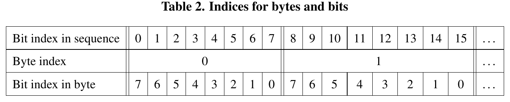

*Tabela 2. Índice do bit na sequência × índice do byte × índice do bit no byte.*

### 3.4 O state

Internamente, o AES opera sobre uma matriz 4×4 de bytes chamada *state*,
denotada por *s*. Cada byte tem um índice de linha r e um de coluna c
(0 ≤ r, c < 4) e é escrito s₍ᵣ,꜀₎ ou s[r,c].

O primeiro passo da cifra copia os bytes de entrada in₀ … in₁₅ para o state:

  **s[r,c] = in[r + 4c]**  para 0 ≤ r < 4 e 0 ≤ c < 4.  (3.6)

Ao final, o state é copiado para os bytes de saída:

  **out[r + 4c] = s[r,c]**  (3.7)

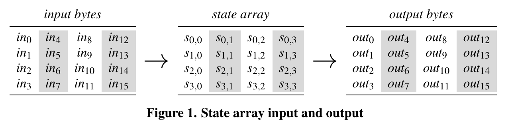

*Figura 1. O state é preenchido coluna a coluna: in₀..in₃ formam a coluna 0.*

### 3.5 Arrays de palavras

Uma *palavra* é uma sequência de quatro bytes; um bloco tem quatro palavras.
As quatro colunas do state são interpretadas como as palavras
v₀ = (s₀,₀ s₁,₀ s₂,₀ s₃,₀), v₁ = (s₀,₁ … s₃,₁) etc. O índice de coluna c vira
o índice da palavra e o índice de linha r vira o índice do byte dentro da
palavra. Para um array de palavras *u*, u[i..i+3] denota u[i], u[i+1],
u[i+2], u[i+3].

> **Nota de RTL.** Com o bloco em `logic [127:0]` na mesma ordem em que o hex
> aparece no documento, in₀ = `[127:120]`, a coluna c = `[127-32c -: 32]` e
> s[r,c] = `[127-8*(r+4*c) -: 8]` — a convenção já usada em `rtl/minisoc_aes/`.

---

## 4. Preliminares matemáticas (§4, p. 8–10)

Em algumas transformações, cada byte do state é interpretado como um dos 256
elementos de um corpo finito (corpo de Galois), GF(2⁸). Para isso, o byte
{b₇ … b₀} é visto como o polinômio

  b(x) = b₇x⁷ + b₆x⁶ + b₅x⁵ + b₄x⁴ + b₃x³ + b₂x² + b₁x + b₀.  (4.1)

Exemplo: {01100011} ↔ x⁶ + x⁵ + x + 1.

### 4.1 Adição em GF(2⁸)

Somam-se os coeficientes módulo 2, isto é, com XOR (⊕): 1⊕1 = 0, 1⊕0 = 1,
0⊕0 = 0. Equivalentemente, soma de bytes = XOR bit a bit. Exemplo, em três
representações equivalentes:

- (x⁶+x⁴+x²+x+1) + (x⁷+x+1) = x⁷+x⁶+x⁴+x²
- {01010111} ⊕ {10000011} = {11010100}
- {57} ⊕ {83} = {d4}

Como os coeficientes são reduzidos módulo 2, **adição e subtração são a mesma
operação**, e a soma de qualquer elemento com ele mesmo é zero.

### 4.2 Multiplicação em GF(2⁸)

O símbolo • denota a multiplicação em GF(2⁸), feita em dois passos:
(1) multiplicam-se os polinômios; (2) reduz-se o resultado módulo o polinômio
fixo

  **m(x) = x⁸ + x⁴ + x³ + x + 1**  (4.3)

A redução pode ser aplicada em passos intermediários, por isso é útil o caso
especial de multiplicar por x ({02}), chamado **xTIMES(b)**:

- se b₇ = 0: xTIMES(b) = {b₆ b₅ b₄ b₃ b₂ b₁ b₀ 0} (deslocamento à esquerda);
- se b₇ = 1: xTIMES(b) = {b₆ b₅ b₄ b₃ b₂ b₁ b₀ 0} ⊕ {00011011} (desloca e faz XOR com {1b}).  (4.5)

Potências maiores de x ({04}, {08}, {10} …) saem da aplicação repetida de
xTIMES. Para b = {57}:

```
{57}•{01} = {57}
{57}•{02} = xTIMES({57}) = {ae}
{57}•{04} = xTIMES({ae}) = {47}
{57}•{08} = xTIMES({47}) = {8e}
{57}•{10} = xTIMES({8e}) = {07}
{57}•{20} = xTIMES({07}) = {0e}
{57}•{40} = xTIMES({0e}) = {1c}
{57}•{80} = xTIMES({1c}) = {38}
```

Com isso se calcula qualquer múltiplo de {57}. Como {13} = {10}⊕{02}⊕{01}:
{57}•{13} = {57}⊕{ae}⊕{07} = **{fe}**.

> **Nota de RTL.** Em hardware, xTIMES é um fio deslocado mais 3 portas XOR
> controladas por b₇. {03}•b = xTIMES(b) ⊕ b. Para InvMixColumns:
> {09} = {08}⊕{01}, {0b} = {08}⊕{02}⊕{01}, {0d} = {08}⊕{04}⊕{01},
> {0e} = {08}⊕{04}⊕{02}.

### 4.3 Multiplicação de palavras por uma matriz fixa

MixColumns e InvMixColumns são multiplicações de matriz. Em ambos os casos,
as 16 entradas da matriz são bytes de uma única palavra [a₀,a₁,a₂,a₃]. Dada a
palavra de entrada [b₀,b₁,b₂,b₃], a saída [d₀,d₁,d₂,d₃] é

```
d0 = (a0•b0) ⊕ (a3•b1) ⊕ (a2•b2) ⊕ (a1•b3)
d1 = (a1•b0) ⊕ (a0•b1) ⊕ (a3•b2) ⊕ (a2•b3)
d2 = (a2•b0) ⊕ (a1•b1) ⊕ (a0•b2) ⊕ (a3•b3)
d3 = (a3•b0) ⊕ (a2•b1) ⊕ (a1•b2) ⊕ (a0•b3)          (4.8)
```

ou seja, a matriz é circulante: cada linha é a anterior girada uma posição à
direita (Eq. 4.9).

### 4.4 Inversos multiplicativos (opcional)

Para b ≠ {00}, o inverso b⁻¹ é o único byte com b • b⁻¹ = {01}. Pode ser
calculado como b⁻¹ = b²⁵⁴ ou pelo algoritmo de Euclides estendido aplicado a
b(x) e m(x). É usado na definição da S-box.

---

## 5. Especificação do algoritmo (§5, p. 11–12)

A função geral do AES-128/192/256 é CIPHER(); sua inversa é INVCIPHER().
(Informalmente chamadas de "cifragem" e "decifragem"; o documento prefere
termos neutros porque cifras de bloco têm outros usos.)

O núcleo de CIPHER() e INVCIPHER() é uma sequência de transformações fixas do
state chamada *rodada*. Cada rodada exige uma entrada adicional, a *round
key*, um bloco normalmente representado como quatro palavras (16 bytes). A
rotina KEYEXPANSION() recebe a chave (um array de palavras chamado *key*) e
produz um array expandido de palavras *w*, o *key schedule*.

AES-128, AES-192 e AES-256 diferem em três pontos: (1) tamanho da chave;
(2) número de rodadas, que determina o tamanho do key schedule; (3) a
recursão dentro de KEYEXPANSION(). Nenhuma outra configuração do Rijndael está
em conformidade com a norma.

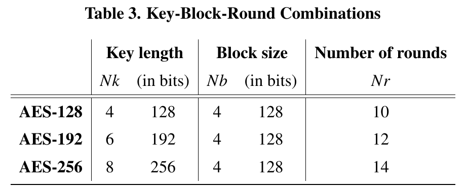

*Tabela 3. Para o projeto: AES-128 → Nk = 4, Nb = 4, Nr = 10.*

As três entradas de CIPHER() são o bloco *in* (16 bytes), o número de rodadas
Nr e as round keys:

  AES-128(in, key) = CIPHER(in, 10, KEYEXPANSION(key))  (5.1)

As permutações inversas são definidas trocando CIPHER() por INVCIPHER().

## 5.1 CIPHER() (p. 12)

As rodadas de CIPHER() são compostas por quatro transformações orientadas a
byte:

- **SUBBYTES()** aplica uma tabela de substituição (S-box) a cada byte;
- **SHIFTROWS()** desloca as linhas do state por offsets diferentes;
- **MIXCOLUMNS()** mistura os dados dentro de cada coluna;
- **ADDROUNDKEY()** combina uma round key com o state.

Nas especificações, o valor transformado é indicado com apóstrofo (b′, s′).
O key schedule é um array w de 4·(Nr+1) palavras.

**Algoritmo 1 — CIPHER()**

```
 1: procedimento CIPHER(in, Nr, w)
 2:   state ← in                                         ▷ ver §3.4
 3:   state ← ADDROUNDKEY(state, w[0..3])                ▷ ver §5.1.4
 4:   para round de 1 até Nr−1 faça
 5:     state ← SUBBYTES(state)                          ▷ ver §5.1.1
 6:     state ← SHIFTROWS(state)                         ▷ ver §5.1.2
 7:     state ← MIXCOLUMNS(state)                        ▷ ver §5.1.3
 8:     state ← ADDROUNDKEY(state, w[4·round..4·round+3])
 9:   fim para
10:   state ← SUBBYTES(state)
11:   state ← SHIFTROWS(state)
12:   state ← ADDROUNDKEY(state, w[4·Nr..4·Nr+3])
13:   retorna state                                      ▷ ver §3.4
14: fim procedimento
```

O primeiro passo (linha 2) copia a entrada para o state. Depois de uma adição
inicial de round key (linha 3), o state passa por Nr aplicações da função de
rodada (linhas 4–12); **a rodada final (linhas 10–12) não tem MIXCOLUMNS()**.
O state final é a saída (linha 13).

### 5.1.1 SUBBYTES() (p. 13–14)

SUBBYTES() é uma transformação **inversível e não linear** do state, na qual
uma tabela de substituição (S-box) é aplicada **independentemente a cada
byte**. A S-box do AES é denotada SBOX().

Seja b o byte de entrada e c = {01100011} = {63}. O byte de saída b′ = SBOX(b)
é obtido compondo duas transformações:

1. Valor intermediário b̃: b̃ = {00} se b = {00}; caso contrário b̃ = b⁻¹
   (inverso multiplicativo, §4.4).  (5.2)
2. Transformação afim sobre os bits de b̃:

   b′ᵢ = b̃ᵢ ⊕ b̃₍ᵢ₊₄₎ mod 8 ⊕ b̃₍ᵢ₊₅₎ mod 8 ⊕ b̃₍ᵢ₊₆₎ mod 8 ⊕ b̃₍ᵢ₊₇₎ mod 8 ⊕ cᵢ  (5.3)

Forma matricial (5.4):

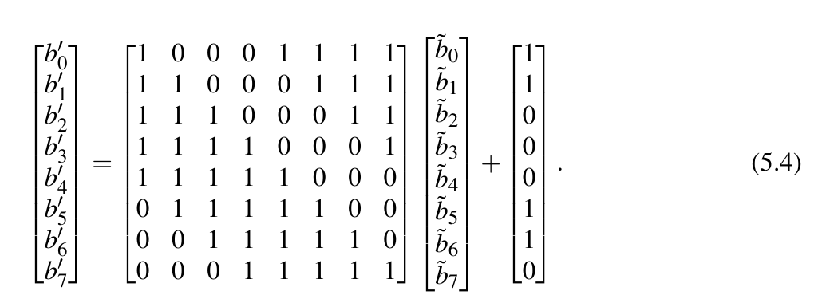

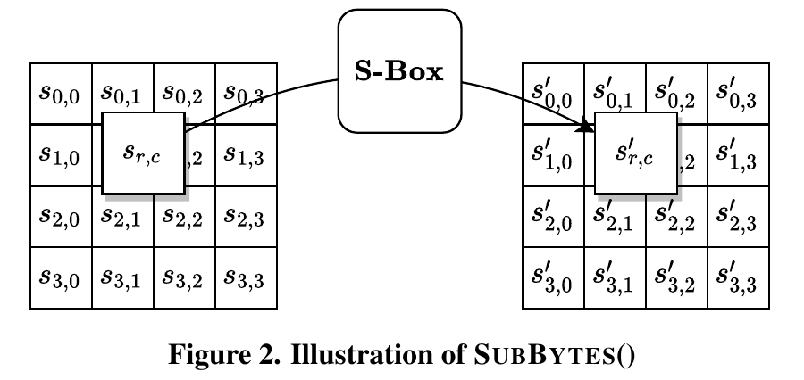

*Figura 2. A S-box é aplicada a cada byte s₍ᵣ,꜀₎ do state.*

A S-box em hexadecimal está na Tabela 4. Exemplo: se s₍ᵣ,꜀₎ = {53}, o valor
substituto está na interseção da linha "5" com a coluna "3": s′₍ᵣ,꜀₎ = **{ed}**.

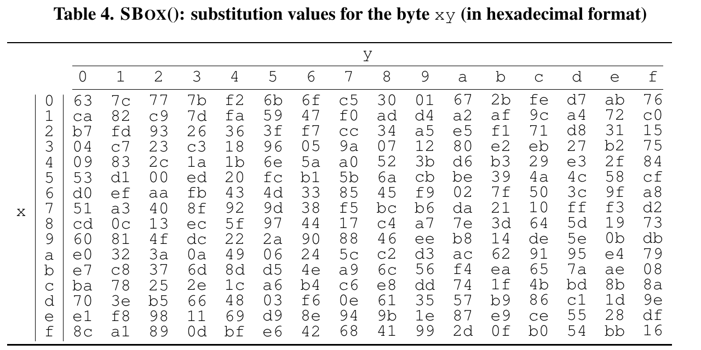

*Tabela 4. SBOX(): valor substituto do byte xy (x = linha, y = coluna).*

### 5.1.2 SHIFTROWS() (p. 14–15)

Os bytes das **três últimas linhas** do state são deslocados ciclicamente. O
número de posições depende do índice de linha r:

  **s′[r,c] = s[r, (c + r) mod 4]**  para 0 ≤ r < 4 e 0 ≤ c < 4.  (5.5)

Na representação da Figura 3, cada byte se move r posições **para a
esquerda** na linha, e os r bytes mais à esquerda voltam pela extremidade
direita. A primeira linha (r = 0) não muda.

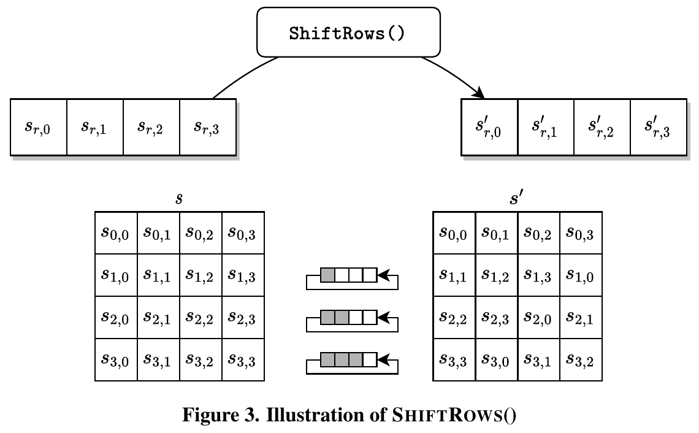

*Figura 3. ShiftRows: linha 1 gira 1 posição, linha 2 gira 2, linha 3 gira 3.*

### 5.1.3 MIXCOLUMNS() (p. 15–16)

Multiplica cada uma das quatro colunas do state por uma única matriz fixa
(§4.3), cujas entradas vêm da palavra

  [a₀, a₁, a₂, a₃] = [{02}, {01}, {01}, {03}].  (5.6)

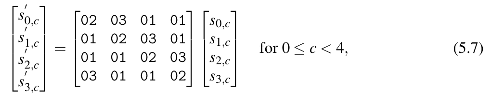

Byte a byte:

```
s'0,c = ({02}•s0,c) ⊕ ({03}•s1,c) ⊕ s2,c ⊕ s3,c
s'1,c = s0,c ⊕ ({02}•s1,c) ⊕ ({03}•s2,c) ⊕ s3,c
s'2,c = s0,c ⊕ s1,c ⊕ ({02}•s2,c) ⊕ ({03}•s3,c)
s'3,c = ({03}•s0,c) ⊕ s1,c ⊕ s2,c ⊕ ({02}•s3,c)          (5.8)
```

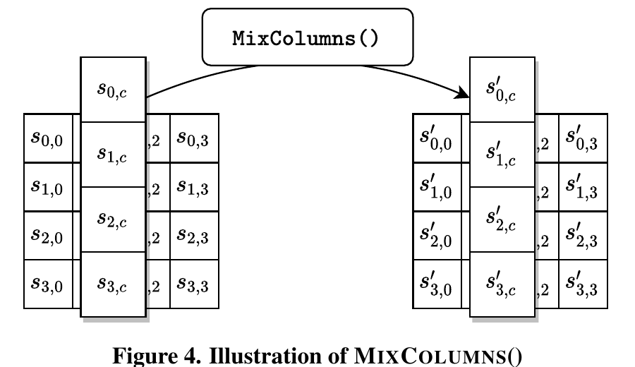

*Figura 4. Cada coluna é transformada independentemente das outras.*

### 5.1.4 ADDROUNDKEY() (p. 16)

A round key é combinada com o state por **XOR bit a bit**. Cada round key tem
quatro palavras do key schedule (§5.2), e cada palavra é combinada com uma
coluna do state:

  [s′₀,꜀, s′₁,꜀, s′₂,꜀, s′₃,꜀] = [s₀,꜀, s₁,꜀, s₂,꜀, s₃,꜀] ⊕ [w₍₄·round+c₎]  para 0 ≤ c < 4  (5.9)

com 0 ≤ round ≤ Nr. Em CIPHER(), ADDROUNDKEY() é chamada **Nr+1 vezes**: uma
antes da primeira rodada e uma em cada uma das Nr rodadas (1 ≤ round ≤ Nr).

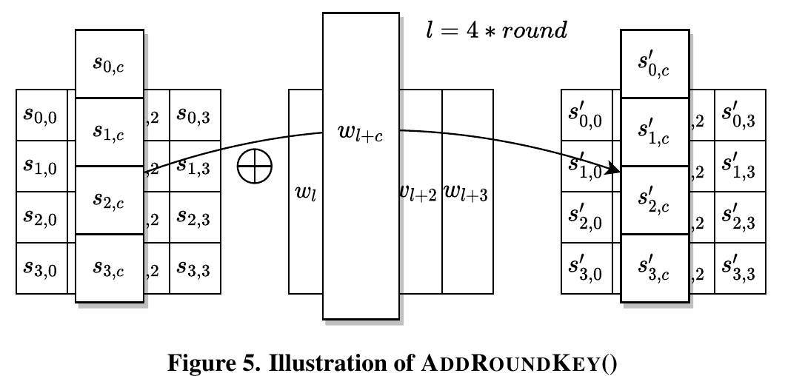

*Figura 5. AddRoundKey, com l = 4·round: a coluna c recebe XOR de w[l+c].*

---

## 5.2 KEYEXPANSION() (p. 17–19) — semana 4

KEYEXPANSION() é aplicada à chave para gerar **4·(Nr+1) palavras** — no
AES-128, **44 palavras = 11 round keys**. São geradas quatro palavras para
cada uma das Nr+1 chamadas de ADDROUNDKEY(). A saída é um array linear w[i],
0 ≤ i < 4·(Nr+1).

A rotina usa 10 palavras fixas Rcon[j], 1 ≤ j ≤ 10, as **constantes de
rodada**. No AES-128, uma constante diferente é usada na geração de cada uma
das 10 round keys (o AES-192 e o AES-256 usam só as 8 e as 7 primeiras).

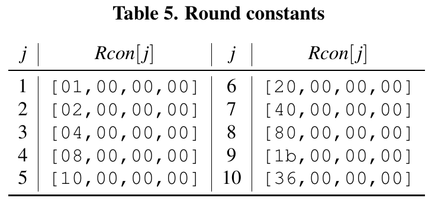

*Tabela 5. Constantes de rodada Rcon[j].*

O byte mais à esquerda de Rcon[j], na forma polinomial, é x^(j−1). Para j > 1,
esses bytes podem ser gerados aplicando xTIMES() sucessivamente ao byte
anterior (por isso {80} é seguido de {1b} e {36}).

KEYEXPANSION() usa duas transformações de palavra. Para a palavra
[a₀, a₁, a₂, a₃]:

  **ROTWORD([a₀,a₁,a₂,a₃]) = [a₁,a₂,a₃,a₀]**  (5.10)

  **SUBWORD([a₀,…,a₃]) = [SBOX(a₀), SBOX(a₁), SBOX(a₂), SBOX(a₃)]**  (5.11)

A expansão segue o Algoritmo 2. **As primeiras Nk palavras são a própria
chave.** Cada palavra seguinte w[i] é gerada recursivamente a partir da
palavra anterior, w[i−1], e da palavra Nk posições antes, w[i−Nk]:

- se i é múltiplo de Nk: **w[i] = w[i−Nk] ⊕ SUBWORD(ROTWORD(w[i−1])) ⊕ Rcon[i/Nk]**;
- apenas no AES-256, se i+4 é múltiplo de 8: w[i] = w[i−Nk] ⊕ SUBWORD(w[i−1]);
- nos demais casos: **w[i] = w[i−Nk] ⊕ w[i−1]**.

**Algoritmo 2 — KEYEXPANSION()**

```
 1: procedimento KEYEXPANSION(key)
 2:   i ← 0
 3:   enquanto i ≤ Nk−1 faça
 4:     w[i] ← key[4·i .. 4·i+3]
 5:     i ← i+1
 6:   fim enquanto                         ▷ ao terminar o laço, i = Nk
 7:   enquanto i ≤ 4·Nr+3 faça
 8:     temp ← w[i−1]
 9:     se i mod Nk = 0 então
10:       temp ← SUBWORD(ROTWORD(temp)) ⊕ Rcon[i/Nk]
11:     senão se Nk > 6 e i mod Nk = 4 então      ▷ só AES-256
12:       temp ← SUBWORD(temp)
13:     fim se
14:     w[i] ← w[i−Nk] ⊕ temp
15:     i ← i+1
16:   fim enquanto
17:   retorna w
18: fim procedimento
```

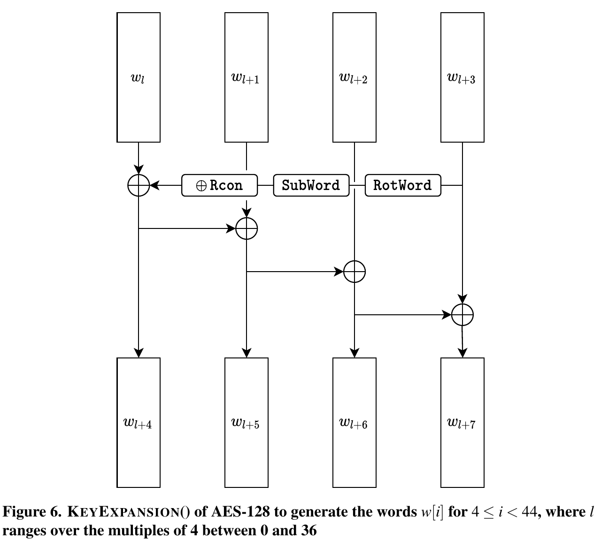

*Figura 6. KEYEXPANSION() do AES-128 gerando w[i] para 4 ≤ i < 44, com l
percorrendo os múltiplos de 4 de 0 a 36.*

> **Nota de RTL.** A Figura 6 já é o diagrama de uma rodada de expansão em
> hardware: de {w_l … w_l+3} saem {w_l+4 … w_l+7} com 1 ROTWORD (só fios),
> 1 SUBWORD (4 S-boxes), o XOR com Rcon (só no byte mais significativo) e 4
> XORs de 32 bits encadeados. Repetida 10 vezes, gera as round keys 1 a 10.

---

## 5.3 INVCIPHER() (p. 18, 22–24)

Para implementar INVCIPHER(), as transformações de CIPHER() (§5.1) são
**invertidas e executadas em ordem reversa**. As transformações inversas do
state — INVSHIFTROWS(), INVSUBBYTES(), INVMIXCOLUMNS() e ADDROUNDKEY() — estão
em §5.3.1–5.3.4. O array w é o key schedule da §5.2.

**Algoritmo 3 — INVCIPHER()**

```
 1: procedimento INVCIPHER(in, Nr, w)
 2:   state ← in                                         ▷ ver §3.4
 3:   state ← ADDROUNDKEY(state, w[4·Nr..4·Nr+3])        ▷ ver §5.1.4
 4:   para round de Nr−1 descendo até 1 faça
 5:     state ← INVSHIFTROWS(state)                      ▷ ver §5.3.1
 6:     state ← INVSUBBYTES(state)                       ▷ ver §5.3.2
 7:     state ← ADDROUNDKEY(state, w[4·round..4·round+3])
 8:     state ← INVMIXCOLUMNS(state)                     ▷ ver §5.3.3
 9:   fim para
10:   state ← INVSHIFTROWS(state)
11:   state ← INVSUBBYTES(state)
12:   state ← ADDROUNDKEY(state, w[0..3])
13:   retorna state
14: fim procedimento
```

> **Nota de RTL.** A decifragem consome as round keys de trás para frente
> (rk10 → rk0). Com chaves pré-computadas, basta inverter o índice. Com
> expansão on-the-fly, é preciso guardar rk10 e recuperar as palavras
> anteriores com w[i−4] = w[i] ⊕ temp, em que temp é calculado a partir de
> w[i−1] como no Algoritmo 2. Ver o trade-off em
> `docs/architecture/microarquitetura_v1.0.md`.

### 5.3.1 INVSHIFTROWS() (p. 22–23)

INVSHIFTROWS() é a inversa de SHIFTROWS(). Os bytes das três últimas linhas
são deslocados ciclicamente:

  **s′[r,c] = s[r, (c − r) mod 4]**  para 0 ≤ r < 4 e 0 ≤ c < 4.  (5.12)

Cada byte se move r posições **para a direita** na linha, e os r bytes mais à
direita voltam pela extremidade esquerda. A primeira linha (r = 0) não muda.

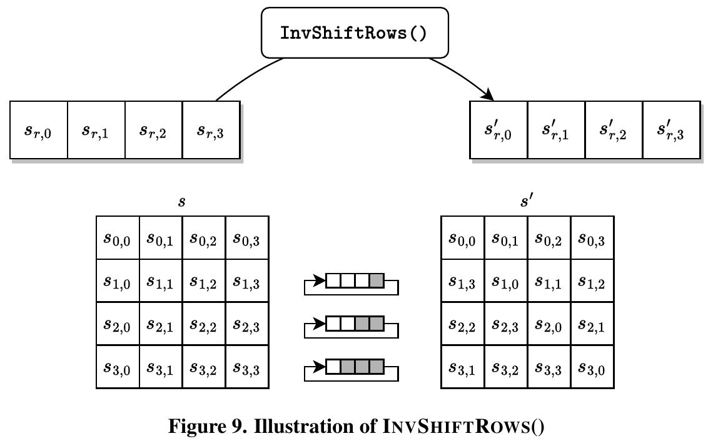

*Figura 9. InvShiftRows.*

### 5.3.2 INVSUBBYTES() (p. 23)

INVSUBBYTES() é a inversa de SUBBYTES(): aplica a inversa da S-box,
INVSBOX(), a cada byte do state. A INVSBOX() é obtida da Tabela 4 trocando os
papéis de entrada e saída:

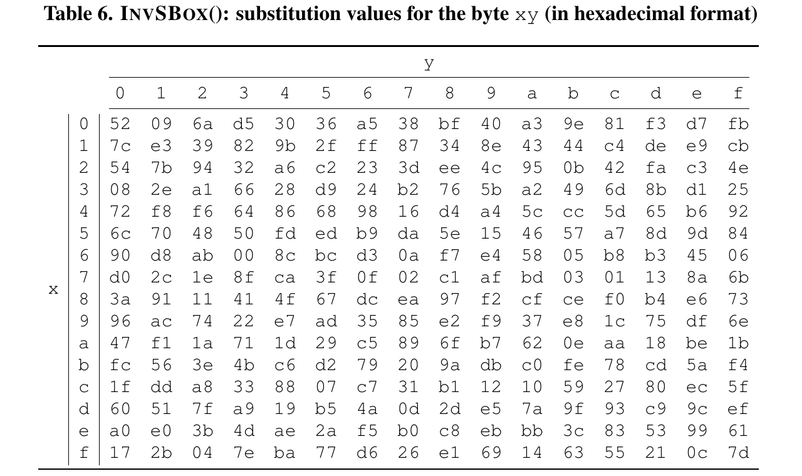

*Tabela 6. INVSBOX(): valor substituto do byte xy. Exemplo: INVSBOX({ed}) = {53}.*

### 5.3.3 INVMIXCOLUMNS() (p. 24)

INVMIXCOLUMNS() é a inversa de MIXCOLUMNS(). Multiplica cada coluna do state
por uma única matriz fixa (§4.3), com entradas da palavra

  [a₀, a₁, a₂, a₃] = [{0e}, {09}, {0d}, {0b}].  (5.13)

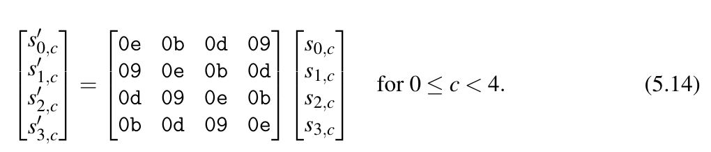

Byte a byte:

```
s'0,c = ({0e}•s0,c) ⊕ ({0b}•s1,c) ⊕ ({0d}•s2,c) ⊕ ({09}•s3,c)
s'1,c = ({09}•s0,c) ⊕ ({0e}•s1,c) ⊕ ({0b}•s2,c) ⊕ ({0d}•s3,c)
s'2,c = ({0d}•s0,c) ⊕ ({09}•s1,c) ⊕ ({0e}•s2,c) ⊕ ({0b}•s3,c)
s'3,c = ({0b}•s0,c) ⊕ ({0d}•s1,c) ⊕ ({09}•s2,c) ⊕ ({0e}•s3,c)     (5.15)
```

### 5.3.4 Inversa de ADDROUNDKEY() (p. 24)

ADDROUNDKEY() (§5.1.4) é **a sua própria inversa** (XOR duas vezes com a
mesma chave devolve o valor original).

### 5.3.5 EQINVCIPHER() — cifra inversa equivalente (p. 24–25)

Várias propriedades do AES permitem uma especificação alternativa da inversa
de CIPHER(), a *cifra inversa equivalente*, EQINVCIPHER(). Nela, as
transformações da função de rodada do Algoritmo 1 são substituídas
diretamente por suas inversas, **na mesma ordem**. A eficiência dessa
estrutura em relação ao Algoritmo 3 é explicada no documento da proposta do
Rijndael [2].

O pseudocódigo (Algoritmo 4) usa um key schedule modificado, o array de
palavras *dw*, gerado por uma extensão de KEYEXPANSION() chamada
KEYEXPANSIONEIC() (Algoritmo 5).

**Algoritmo 4 — EQINVCIPHER()**

```
 1: procedimento EQINVCIPHER(in, Nr, dw)
 2:   state ← in
 3:   state ← ADDROUNDKEY(state, dw[4·Nr..4·Nr+3])
 4:   para round de Nr−1 descendo até 1 faça
 5:     state ← INVSUBBYTES(state)
 6:     state ← INVSHIFTROWS(state)
 7:     state ← INVMIXCOLUMNS(state)
 8:     state ← ADDROUNDKEY(state, dw[4·round..4·round+3])
 9:   fim para
10:   state ← INVSUBBYTES(state)
11:   state ← INVSHIFTROWS(state)
12:   state ← ADDROUNDKEY(state, dw[0..3])
13:   retorna state
14: fim procedimento
```

**Algoritmo 5 — KEYEXPANSIONEIC()**

```
 1: procedimento KEYEXPANSIONEIC(key)
 2:   i ← 0
 3:   enquanto i ≤ Nk−1 faça
 4:     w[i] ← key[4i..4i+3]
 5:     dw[i] ← w[i]
 6:     i ← i+1
 7:   fim enquanto                         ▷ ao terminar o laço, i = Nk
 8:   enquanto i ≤ 4·Nr+3 faça
 9:     temp ← w[i−1]
10:     se i mod Nk = 0 então
11:       temp ← SUBWORD(ROTWORD(temp)) ⊕ Rcon[i/Nk]
12:     senão se Nk > 6 e i mod Nk = 4 então
13:       temp ← SUBWORD(temp)
14:     fim se
15:     w[i] ← w[i−Nk] ⊕ temp
16:     dw[i] ← w[i]
17:     i ← i+1
18:   fim enquanto
19:   para round de 1 até Nr−1 faça
20:     i ← 4·round
21:     dw[i..i+3] ← INVMIXCOLUMNS(dw[i..i+3])   ▷ note a mudança de tipo
22:   fim para
23:   retorna dw
24: fim procedimento
```

A primeira e a última round keys de dw são iguais às de w; as demais são
modificadas nas linhas 19–22. O comentário da linha 21 refere-se à entrada de
INVMIXCOLUMNS(): o array unidimensional de palavras é convertido em um array
bidimensional de bytes, como na Figura 1.

> **Por que importa.** Na forma equivalente, cifragem e decifragem têm a
> mesma sequência de blocos (Sub → Shift → Mix → AddRoundKey), o que facilita
> compartilhar o controle no `minisoc_aes_dp`. O custo é aplicar
> InvMixColumns às round keys 1 a 9. Vale citar como alternativa considerada
> na justificativa da arquitetura.

---

## 6. Considerações de implementação (§6, p. 26–27)

### 6.1 Requisitos de tamanho de chave

Uma implementação do AES **deve suportar pelo menos um** dos três tamanhos de
chave (128, 192 ou 256 bits; Nk = 4, 6 ou 8). Suportar dois ou três é
opcional e pode favorecer a interoperabilidade. → Só AES-128 já está em
conformidade.

### 6.2 Restrições de chave

Se a chave foi gerada adequadamente (ver NIST SP 800-133 Rev. 2), não há
restrição ao seu uso no AES.

### 6.3 Extensões de parâmetros

A Tabela 3 define os valores permitidos de Nk, Nb e Nr. Revisões futuras
podem alterá-los; implementadores podem projetar pensando nessa flexibilidade.

### 6.4 Sugestões de implementação para diversas plataformas

Variações de implementação são possíveis e podem trazer vantagens de
desempenho ou outras. **Dados a mesma chave e os mesmos dados de entrada,
qualquer implementação que produza a mesma saída que o algoritmo
especificado é uma implementação equivalente do AES.**

A proposta do AES [2] e outros recursos da página do AES [7] sugerem como
implementar o algoritmo eficientemente em várias plataformas. Essas sugestões
explicam o funcionamento interno, mas **não protegem contra ataques de
implementação**.

Uma implementação física pode vazar informação dependente da chave por
**canais laterais**, como o tempo de cálculo, ou quando falhas são injetadas
no cálculo. Ataques não invasivos podem funcionar mesmo com mecanismos de
detecção de violação física. Por exemplo, ataques de *cache-timing* afetam
implementações em software que usam cache para acelerar o acesso à memória.

A proteção contra ataques de implementação deve ser considerada quando
aplicável. Isso está fora do escopo do documento, mas é avaliado nos testes de
conformidade do programa de validação do NIST (CMVP).

### 6.5 Modos de operação

Modos de operação de cifras de bloco são funções criptográficas que usam uma
cifra de bloco para prover serviços como confidencialidade e autenticação. Os
modos recomendados pelo NIST estão na série **NIST SP 800-38**. → Para ECB,
CBC e CTR (semana 6), ler a **SP 800-38A**.

---

## Apêndice A.1 — Expansão de uma chave de 128 bits (p. 29–30)

O apêndice mostra o desenvolvimento do key schedule. Os valores multibyte
seguem a notação da §3; tudo está em hexadecimal, exceto a coluna i.

Chave: `2b 7e 15 16 28 ae d2 a6 ab f7 15 88 09 cf 4f 3c`, com Nk = 4, o que dá

`w0 = 2b7e1516`  `w1 = 28aed2a6`  `w2 = abf71588`  `w3 = 09cf4f3c`

Colunas da tabela: i; *temp*; após ROTWORD(); após SUBWORD(); Rcon[i/Nk];
após XOR com Rcon; w[i−Nk]; w[i] = temp ⊕ w[i−Nk].

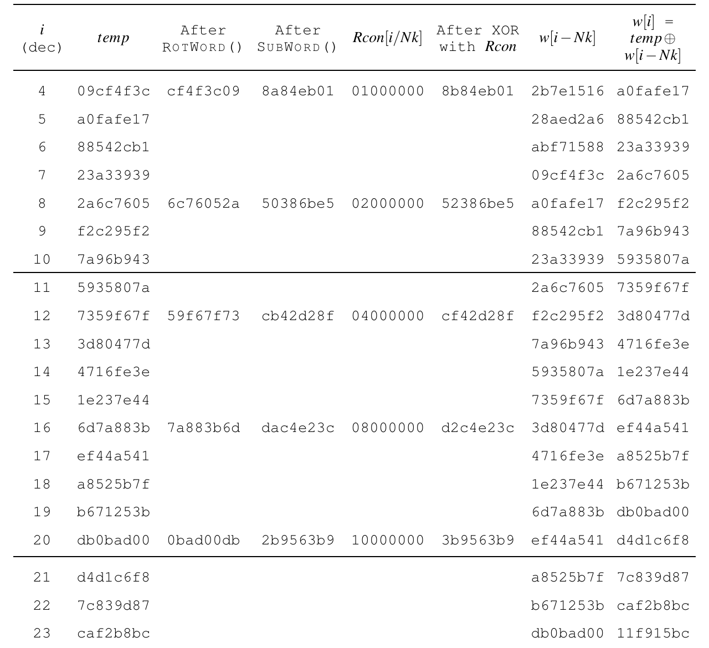

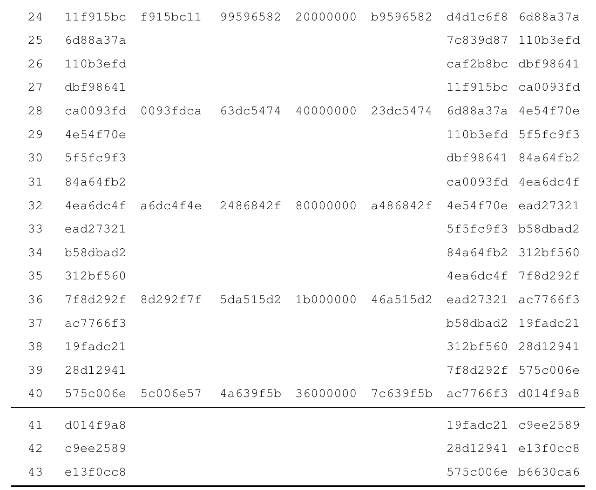

Round keys resultantes (cada linha = w[4k..4k+3]):

| k  | Round key                              |
|----|----------------------------------------|
| 0  | `2b7e1516 28aed2a6 abf71588 09cf4f3c`  |
| 1  | `a0fafe17 88542cb1 23a33939 2a6c7605`  |
| 2  | `f2c295f2 7a96b943 5935807a 7359f67f`  |
| 3  | `3d80477d 4716fe3e 1e237e44 6d7a883b`  |
| 4  | `ef44a541 a8525b7f b671253b db0bad00`  |
| 5  | `d4d1c6f8 7c839d87 caf2b8bc 11f915bc`  |
| 6  | `6d88a37a 110b3efd dbf98641 ca0093fd`  |
| 7  | `4e54f70e 5f5fc9f3 84a64fb2 4ea6dc4f`  |
| 8  | `ead27321 b58dbad2 312bf560 7f8d292f`  |
| 9  | `ac7766f3 19fadc21 28d12941 575c006e`  |
| 10 | `d014f9a8 c9ee2589 e13f0cc8 b6630ca6`  |

> **Uso.** Testbench do `minisoc_aes_key_exp`: comparar as 11 round keys
> (ou as 44 palavras) com esta tabela.

---

## Apêndice B — Exemplo de cifragem (p. 34–35)

O diagrama mostra os valores do state ao longo da cifragem para bloco e chave
de 16 bytes (Nb = 4, Nk = 4):

```
Input = 32 43 f6 a8 88 5a 30 8d 31 31 98 a2 e0 37 07 34
Key   = 2b 7e 15 16 28 ae d2 a6 ab f7 15 88 09 cf 4f 3c
```

As round keys vêm do exemplo do Apêndice A.1. Colunas: número da rodada;
início da rodada; após SubBytes; após ShiftRows; após MixColumns; valor da
round key. **Cada matriz é o state 4×4 (Fig. 1): a primeira coluna da
entrada é 32 43 f6 a8.**

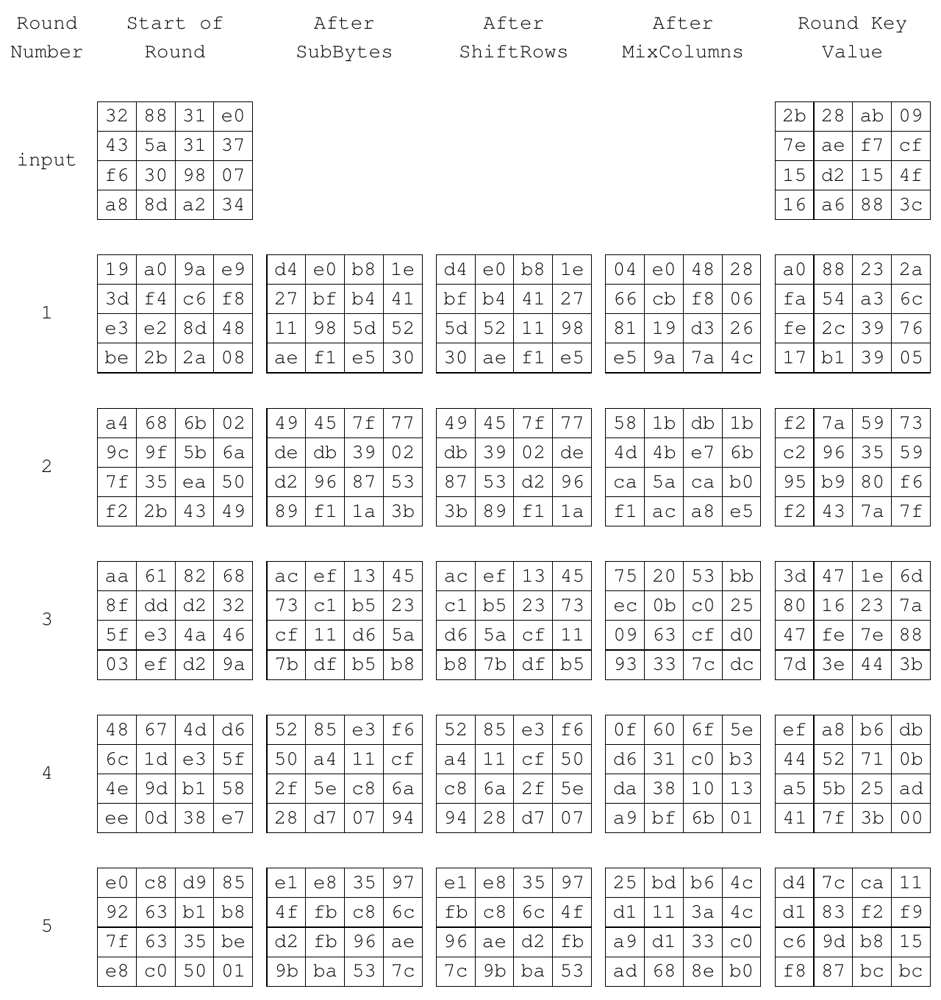

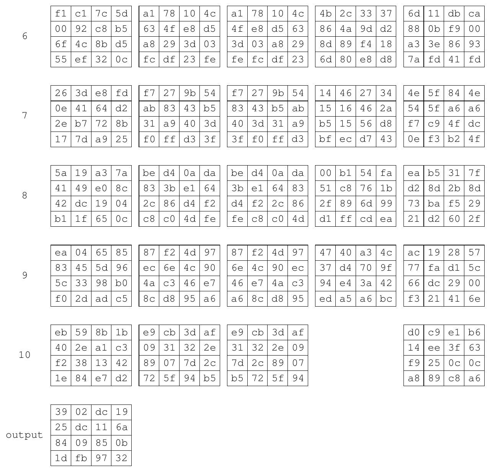

Saída: **`39 25 84 1d 02 dc 09 fb dc 11 85 97 19 6a 0b 32`**.

> **Uso.** Lido de baixo para cima, o mesmo exemplo valida a decifragem:
> INVCIPHER(`3925841d…0b32`) deve devolver `3243f6a8…0734`, e cada state
> intermediário deve coincidir com o da cifragem na rodada correspondente.

---

## Apêndice C — Vetores de exemplo (p. 36)

Na edição upd1, o Apêndice C só informa que o NIST CSRC mantém um site com
"exemplos com valores intermediários" para o AES (referência [8]):
<https://csrc.nist.gov/projects/cryptographic-standards-and-guidelines/example-values>.
O vetor clássico do antigo C.1 (chave `000102…0f`, texto
`00112233445566778899aabbccddeeff`, cifrado `69c4e0d86a7b0430d8cdb78070b4c55a`)
está nesse site e no FIPS 197 de 2001.
